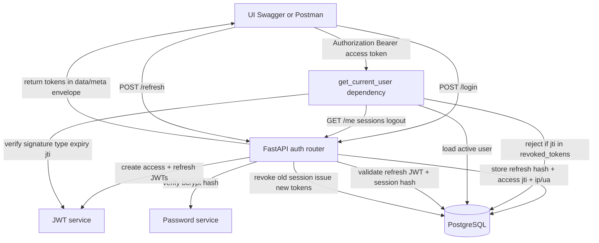

# Architecture note — Authentication & Token Management

One-page data flow for the Nexus One intern prototype.

## Data flow

## Token handling

| Token | Lifetime | Stored in DB | Used for |
| --- | --- | --- | --- |
| Access JWT | 15 minutes | `jti` on logout in `revoked_tokens` | `/me`, `/logout`, `/sessions` |
| Refresh JWT | 7 days | SHA-256 hash only in `auth_sessions` | `/refresh` |

Access tokens include `sub`, `user_id`, `roles`, `company_id`, `jti`, `iat`, `exp`, `token_type`. Passwords are never in tokens. Raw refresh tokens are never stored.

## Session lifecycle

1. Login creates an `auth_sessions` row (`refresh_token_hash`, `access_token_jti`, `expires_at`).
2. Refresh revokes that row and creates a new one (rotation).
3. Logout marks the session revoked and inserts the access `jti` into `revoked_tokens`.
4. A later `/me` with that access token returns `401 AUTH_TOKEN_REVOKED`.

## Tables

- `users` — email, bcrypt `password_hash`, `full_name`, role, `company_id`, `is_active`, lock fields
- `auth_sessions` — one login session per refresh token hash, plus `ip_address` / `user_agent`
- `revoked_tokens` — access-token deny list by `jti`

## Out of scope for this assignment

MFA, SSO, password-reset email, Redis, device fingerprinting, five-failure lockout, and production deploy. `company_id` is a user field and JWT claim only (single-tenant).

**JWT algorithm: HS256 (default) or RS256.** `JWT_ALGORITHM` is validated at
startup (`app/core/config.py`); anything else, or RS256 without a usable key,
fails immediately with a clear error rather than breaking on a user's first
login.

- *HS256* signs and verifies with the shared secret `JWT_SECRET_KEY`.
- *RS256* signs with an RSA private key (`JWT_PRIVATE_KEY_PATH`, or
  `JWT_PRIVATE_KEY` with `
` for newlines; 2048 bits minimum) and puts a
  `kid` in the token header. Other Nexus One modules verify with the public
  key from `GET /.well-known/jwks.json` and never hold a signing secret.
  `scripts/generate_jwt_keys.py` creates a pair. To rotate, point
  `JWT_PRIVATE_KEY_PATH` at the new key and list the old public key in
  `JWT_PREVIOUS_PUBLIC_KEY_PATHS` until its tokens expire. To switch from
  HS256, leave `JWT_SECRET_KEY` set: tokens signed with it keep verifying (as
  HS256 only) until they expire, then remove it.
- Verification never trusts the token's own `alg`: each key is tried only with
  its own algorithm, so the public key can't be presented as an HMAC secret.

**Rate limiting and client address.** Login and register are limited per
caller (`RATE_LIMIT_LOGIN_PER_MINUTE`, `RATE_LIMIT_REGISTER_PER_MINUTE`).
Counters are in PostgreSQL (`rate_limit_counters`) so every worker and
container shares them; `RATE_LIMIT_BACKEND=memory` keeps them per process (a
single dev server only). Behind a reverse proxy (see `ops/nginx/nginx.conf`)
set `TRUSTED_PROXIES` to the proxy's address range, e.g.
`TRUSTED_PROXIES=10.0.0.0/8,172.16.0.0/12`; `X-Forwarded-For` is believed only
when the connection comes from one of those, and otherwise ignored.
`RATE_LIMIT_ENABLED=false` exists for the test suite and is refused in
production.

**Login responses.** A wrong password, an unknown email, an inactive account
and a locked account all return the same `401 AUTH_INVALID_CREDENTIALS`, so
the response never reveals whether an account exists. The audit log keeps the
real reason (`invalid_credentials`, `inactive_account`, `account_locked`).
Passwords over bcrypt's 72 bytes are simply wrong at login. Registration is
the same: `POST /auth/register` returns `202` with one generic message whether
the address is new or already has an account (no id, role or email in the
body), hashes the password either way so timing matches, and records a
duplicate as `register_duplicate` in the audit log.
