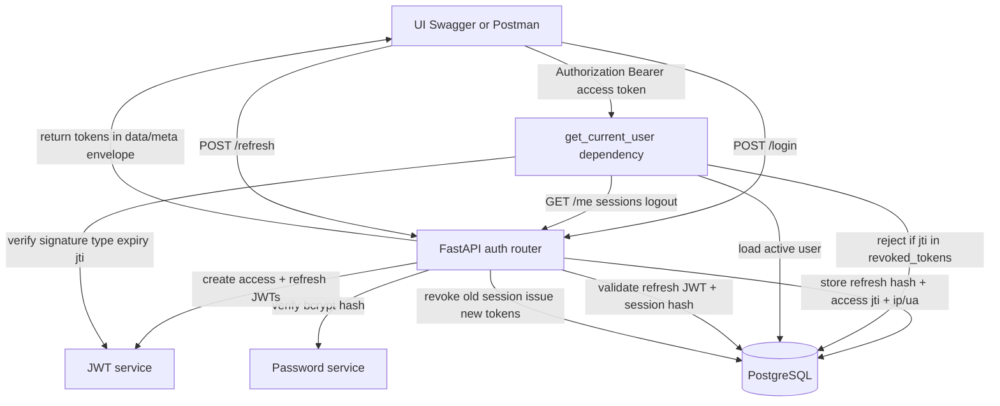

# Architecture note — Authentication & Token Management

One-page data flow for the Nexus One intern prototype.

## Data flow

## Token handling

| Token | Lifetime | Stored in DB | Used for |
| --- | --- | --- | --- |
| Access JWT | 15 minutes | `jti` on logout in `revoked_tokens` | `/me`, `/logout`, `/sessions` |
| Refresh JWT | 7 days | SHA-256 hash only in `auth_sessions` | `/refresh` |

Access tokens include `sub`, `user_id`, `roles`, `company_id`, `jti`, `iat`, `exp`, `token_type`. Passwords are never in tokens. Raw refresh tokens are never stored.

## Session lifecycle

1. Login creates an `auth_sessions` row (`refresh_token_hash`, `access_token_jti`, `expires_at`).
2. Refresh revokes that row and creates a new one (rotation).
3. Logout marks the session revoked and inserts the access `jti` into `revoked_tokens`.
4. A later `/me` with that access token returns `401 AUTH_TOKEN_REVOKED`.

## Tables

- `users` — email, bcrypt `password_hash`, `full_name`, role, `company_id`, `is_active`, lock fields
- `auth_sessions` — one login session per refresh token hash, plus `ip_address` / `user_agent`
- `revoked_tokens` — access-token deny list by `jti`

## Out of scope for this assignment

MFA, SSO, password-reset email, Redis, device fingerprinting, five-failure lockout, and production deploy. `company_id` is a user field and JWT claim only (single-tenant).

**JWT algorithm: HS256 only.** There is no RSA keypair loading anywhere in
this codebase — `app/core/jwt_service.py` signs and verifies every token
with a single shared secret (`JWT_SECRET_KEY`). `JWT_ALGORITHM` is validated
at startup (`app/core/config.py`) and rejects anything other than `HS256`;
setting it to `RS256` (or any other algorithm) fails immediately with a
clear error rather than breaking later on a user's first login.
